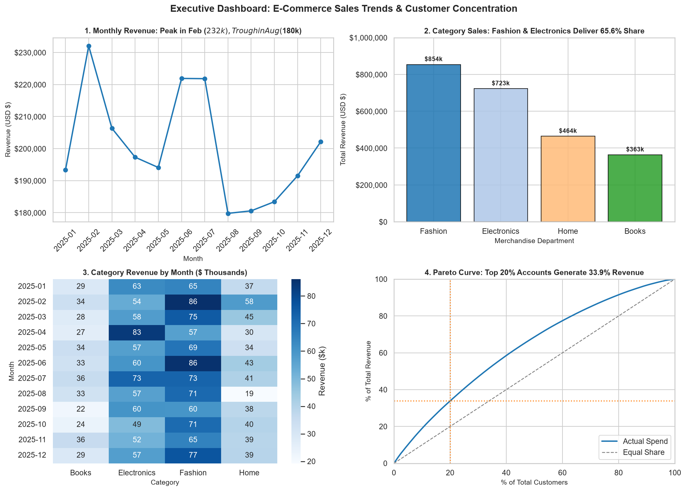

# Customer Churn & E-Commerce Sales Trend Analysis
[](https://www.python.org/)
[](https://jupyter.org/)
[](https://pandas.pydata.org/)
[](https://seaborn.pydata.org/)
[](https://opensource.org/licenses/MIT)

An end-to-end commercial sales trend and customer value analysis for an e-commerce platform, completed as part of the **InternCircle Data Science & AI Internship (Project 03)**.

The project evaluates monthly revenue trajectories, seasonal growth fluctuations, merchandise department dynamics, and customer spend concentration using the Pareto principle (80/20 rule), concluding with a one-page executive brief and data-backed recommendations.

---

## 📊 Executive Sales & Customer Dashboard



---

## 📌 Business Questions Addressed (Step 1)

1. **Seasonal Trajectory:** Which calendar months generate peak revenue, which represent annual troughs, and what is the month-over-month (MoM) growth pattern?
2. **Category Performance:** Which merchandise categories dominate total revenue volume, how do their Average Order Values (AOV) compare, and how do sales fluctuate across the year?
3. **Customer Value & Pareto Concentration:** What percentage of total commercial revenue is concentrated within the top 10% and top 20% of customer accounts?
4. **Actionable Commercial Strategy:** What concrete operational, merchandising, and retention interventions should leadership prioritize?

---

## 📈 Quantitative Key Findings (Steps 2–6)

| Dimension | Key Metric / Statistics | Managerial Finding |
| :--- | :--- | :--- |
| **Gross Annual Revenue** | **Total Sales:** $2,404,233.29<br>**Total Orders:** 2,000<br>**AOV:** $1,202.12 | Steady retail performance averaging ~$200,352 per month across 300 active customer accounts. |
| **Monthly Seasonality** | **Peak:** Feb ($232,027.20 \| +20.01% MoM)<br>**Trough:** Aug ($179,783.75 \| -18.95% MoM)<br>**Q4 Recovery:** +5.55% in Dec | Sharp mid-summer decline in August ($180k) before an autumn recovery returning to >$200k in December. |
| **Department Sales** | **Fashion:** $853,984.93 (35.52%)<br>**Electronics:** $722,645.53 (30.06%)<br>**Home:** $464,114.66 (19.30%)<br>**Books:** $363,488.17 (15.12%) | **Fashion** and **Electronics** drive **65.58%** ($1.58M) of total commercial revenue across 1,321 transactions. |
| **Average Order Value (AOV)** | **Fashion:** $1,219.98<br>**Books:** $1,219.76<br>**Home:** $1,218.15<br>**Electronics:** $1,163.68 | Ticket sizes are uniform across departments (~$1,164 to $1,220); top department revenues stem from purchase frequency, not ticket inflation. |
| **Pareto Spend Distribution** | **Top 10% (30 customers):** 18.94% ($455k)<br>**Top 20% (60 customers):** 33.88% ($815k)<br>**Top Account Spend:** >$13,577 avg | Strong revenue concentration where the top 20% of customer accounts anchor more than one-third of total business revenue. |

---

## 💡 Strategic Business Recommendations (Step 7)

1. **Launch a Dedicated VIP Account Tier for the Top 20% Customer Cohort:**
   * *Evidence:* 60 accounts generate **33.88%** ($814,643.08) of annual revenue.
   * *Action:* Institute an exclusive loyalty tier featuring early access to new lines, dedicated concierges, and tier-based discounts. Retaining just 4 of these top accounts protects over $54,000 in revenue.
2. **Prioritize Working Capital and Marketing in Fashion & Electronics:**
   * *Evidence:* Fashion and Electronics generate **65.58%** ($1.58M) of all gross receipts.
   * *Action:* Direct 65%+ of acquisition capital and inventory procurement to Fashion and Electronics, utilizing Home and Books merchandise as bundled cross-sell checkout suggestions.
3. **Deploy Counter-Cyclical Campaigns to Mitigate the Q3 Seasonal Trough:**
   * *Evidence:* Revenue drops to an annual trough of **$179,783.75** in August (-18.95% MoM drop from July).
   * *Action:* Run mid-summer promotional events ("Cyber Summer Week" / "Back-to-School") in late July/August to bridge the $52,243 revenue gap between peak and trough months.

---

## 📂 Repository Structure

```text
├── sales_trend_overview.png       # 2x2 executive dashboard figure saved at 150 DPI
├── sales_trend_analysis.ipynb     # Fully executed Jupyter Notebook with all outputs & plots
├── sales_trend_analysis.html      # Interactive standalone HTML report
├── business_brief.md              # One-page executive business brief
├── build_project3.py              # Automated build, execution, and export script
├── requirements.txt               # Environment dependencies
└── README.md                      # Comprehensive project documentation
```

---

## 🚀 Setup & Execution

### 1. Clone the Repository
```bash
git clone https://github.com/Anish76948/ecommerce-sales-trend-analysis.git
cd ecommerce-sales-trend-analysis
```

### 2. Install Dependencies
```bash
python -m venv venv
# Windows:
venv\Scripts\activate
# Linux/macOS:
source venv/bin/activate

pip install -r requirements.txt
```

### 3. Launch Notebook
```bash
jupyter notebook sales_trend_analysis.ipynb
```
Or view [`sales_trend_analysis.html`](sales_trend_analysis.html) directly in any web browser.

---

## 📜 License
This project is open-source and released under the [MIT License](LICENSE).
